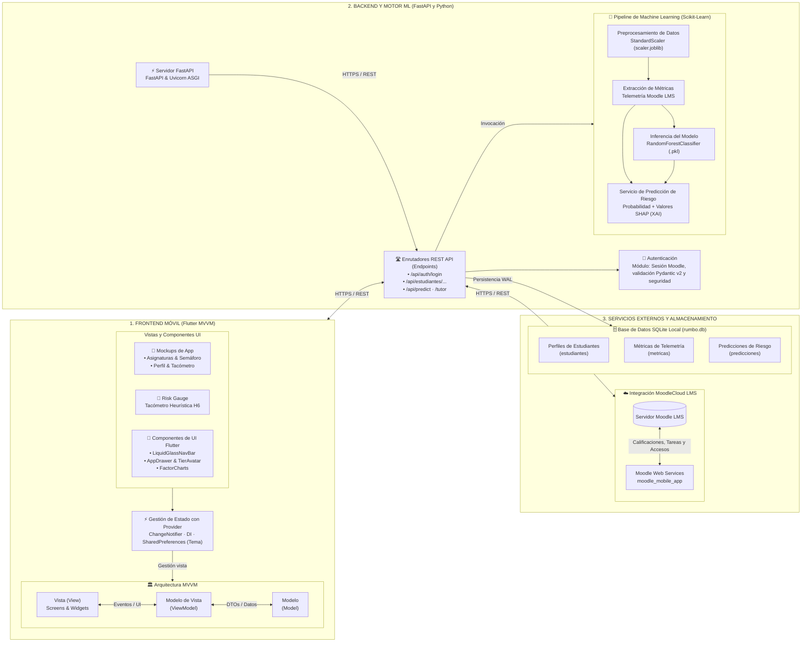

# Arquitectura del Sistema · RUMBO
> **Mobile Learning & Analítica Predictiva con Inteligencia Artificial**  
> *Facultad de Ingeniería de Sistemas e Informática (FISI) — UNMSM*  
> *Curso: Taller de Construcción de Software Móvil — Docente: Dr. Iván Carlo Petrlik Azabache*

---

## 📌 Imagen del Diagrama de Arquitectura
El diagrama visual en alta definición se encuentra disponible en:
- [`Docs/diagrama_arquitectura_app.png`](file:///c:/Users/camil/Desktop/ProyectoMobileLV1.0/Docs/diagrama_arquitectura_app.png)
- [`Docs/diagramas/diagrama_arquitectura_app.png`](file:///c:/Users/camil/Desktop/ProyectoMobileLV1.0/Docs/diagramas/diagrama_arquitectura_app.png)

---

## 🏗️ Representación del Diagrama de Arquitectura (3 Bloques Principales)

---

## 🔍 Explicación de los 3 Bloques para la Exposición

### Bloque 1: Frontend Móvil (Flutter MVVM)
1. **Mockups y Pantallas**:
   - `CoursesScreen`: Lista de asignaturas con semáforo de riesgo en tiempo real (Bajo, Moderado, Crítico).
   - `RiskScreen`: Detalle de riesgo con el tacómetro visual **Risk Gauge**, aplicando la **Heurística H6 de Nielsen** (margen de incertidumbre, ej: 78–91%).
   - `FactorsScreen`: Desglose explicativo de factores de impacto basado en SHAP.
   - `GamificationScreen`: Sistema de 6 rangos adaptado a 14 semanas con avatar y misiones renovables.
2. **Componentes de UI Flutter**:
   - Widgets modulares y desacoplados: [`LiquidGlassNavBar`](file:///c:/Users/camil/Desktop/ProyectoMobileLV1.0/Frontend/lib/views/widgets/liquid_glass_nav_bar.dart), [`AppDrawer`](file:///c:/Users/camil/Desktop/ProyectoMobileLV1.0/Frontend/lib/views/widgets/app_drawer.dart), [`TierAvatar`](file:///c:/Users/camil/Desktop/ProyectoMobileLV1.0/Frontend/lib/views/widgets/tier_avatar.dart).
3. **Gestión de Estado con Provider**:
   - Uso de `ChangeNotifier` para notificar reactivamente a la UI sin recrear el árbol de widgets innecesariamente.
   - Integración con `SharedPreferences` para persistir la preferencia de Modo Claro / Modo Oscuro localmente (**Laboratorio 06**).
4. **Arquitectura MVVM**:
   - **Vista (View)**: Únicamente renderizado declarativo y captura de eventos de usuario.
   - **Modelo de Vista (ViewModel)**: Lógica de presentación observable (`AuthViewModel`, `RiesgoViewModel`, `CoursesViewModel`, `ThemeViewModel`).
   - **Modelo (Model)**: DTOs inmutables fuertemente tipados con constructores `fromJson`.

---

### Bloque 2: Backend y Motor ML (FastAPI y Python)
1. **Servidor FastAPI**:
   - Framework ASGI de alto rendimiento sobre Uvicorn.
   - Documentación OpenAPI/Swagger autogenerada y disponible en `/docs`.
2. **Enrutadores REST API (Endpoints)**:
   - `/api/auth/login`: Autenticación real contra MoodleCloud LMS y emisión de token.
   - `/api/estudiantes/{id}/cursos`: Consulta y sincronización de asignaturas matriculadas.
   - `/api/estudiantes/{id}/cursos/{c}/riesgo`: Detalle completo de riesgo, tacómetro H6 y factores explicativos.
   - `/api/predict`: Endpoint de inferencia directa para escenarios analíticos.
   - `/api/tutor/chat`: Asistente conversacional pedagógico para la autorregulación del estudio.
3. **Pipeline de Machine Learning (Scikit-Learn)**:
   - **Preprocesamiento**: Normalización de las variables numéricas con `StandardScaler` (`scaler.joblib`).
   - **Extracción de Métricas**: Obtención de variables conductuales (días de inactividad, margen de entrega, promedio y slope de notas).
   - **Inferencia del Modelo**: Clasificador supervisado `RandomForestClassifier` (`random_forest_model.pkl`).
   - **Servicio de Predicción de Riesgo & SHAP**: Cálculo del porcentaje de riesgo y atribución de factores positivos y negativos mediante XAI (*Explainable Artificial Intelligence*).
4. **Autenticación**:
   - Validación rigurosa de entradas y salidas mediante modelos **Pydantic v2**, manejo de cabeceras seguras y soporte de sesión offline (`DEMO`).

---

### Bloque 3: Servicios Externos y Almacenamiento
1. **Integración MoodleCloud LMS**:
   - Conexión vía protocolo HTTPS/REST hacia la API oficial `moodle_mobile_app`.
   - Consulta de calificaciones con `gradereport_user_get_grade_items`.
   - Extracción de tareas y plazos con `mod_assign_get_assignments`.
   - Sincronización de cursos y último acceso con `core_enrol_get_users_courses`.
2. **Base de Datos SQLite Local (`rumbo.db`)**:
   - Base de datos relacional local configurada con **Write-Ahead Logging (`PRAGMA journal_mode = WAL;`)** para concurrencia lectura/escritura y claves foráneas activas (`PRAGMA foreign_keys = ON;`).
   - Almacena las tablas:
     - `estudiantes`: Perfil universitario, token y ID de Moodle.
     - `metricas`: Telemetría académica extraída del aula virtual.
     - `predicciones`: Resultados de la IA, bandas H6 y factores SHAP serializados.
     - `cursos`, `historial_accesos` y `revisiones_diagnostico`: Soporte a la navegación y gamificación semanal.

---

> 🔗 **Ver también**:
> - [Diagrama Entidad-Relación de Base de Datos](file:///c:/Users/camil/Desktop/ProyectoMobileLV1.0/Docs/DIAGRAMA_BASE_DE_DATOS.md)
> - [Manual de Exposición y Flujo de Datos](file:///c:/Users/camil/Desktop/ProyectoMobileLV1.0/README.md)
