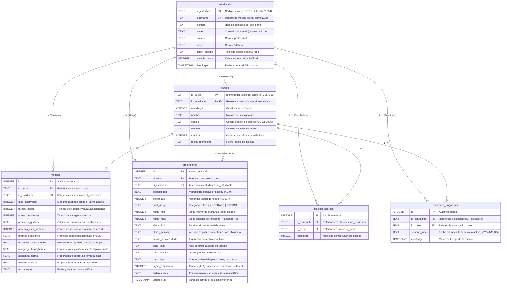

# Diagrama Entidad-Relación · Base de Datos Local (`rumbo.db`)
> **Sistema RUMBO · Mobile Learning Moodle**  
> *Facultad de Ingeniería de Sistemas e Informática (FISI) — UNMSM*

---

## 📌 Imagen del Diagrama
El diagrama visual en alta definición se encuentra generado en:
- [`Docs/diagrama_er_base_de_datos.png`](file:///c:/Users/camil/Desktop/ProyectoMobileLV1.0/Docs/diagrama_er_base_de_datos.png)
- [`Docs/diagramas/diagrama_er_base_de_datos.png`](file:///c:/Users/camil/Desktop/ProyectoMobileLV1.0/Docs/diagramas/diagrama_er_base_de_datos.png)

---

## 🏛️ Representación Mermaid (ER Diagram)

---

## 🔬 Especificación Técnica de las Tablas

### 1. Tabla `estudiantes`
- **Propósito**: Almacena las cuentas sincronizadas desde el aula virtual Moodle LMS y el perfil universitario.
- **Clave Primaria**: `id_estudiante` (`TEXT`).
- **Restricción Unique**: `username` (`TEXT UNIQUE`) para evitar perfiles duplicados.

### 2. Tabla `cursos`
- **Propósito**: Asignaturas en las que está matriculado cada estudiante.
- **Clave Primaria Compuesta**: `(id_curso, id_estudiante)` (`TEXT`).
- **Clave Foránea**: `id_estudiante REFERENCES estudiantes(id_estudiante)`.

### 3. Tabla `metricas`
- **Propósito**: Almacena la telemetría conductual y académica extraída desde las APIs Web Services de Moodle.
- **Variables Clave para ML**:
  - `dias_inactividad`: Días transcurridos sin entrar al curso en Moodle.
  - `tareas_pendientes` / `tareas_totales`: Tasa de rezago de entregas.
  - `promedio_quizzes` y `promedio_historico`: Rendimiento cognitivo previo.
  - `tendencia_calificaciones` (Slope): Pendiente de notas en los cortes del semestre.
  - `margen_entrega_horas`: Hábitos de entrega (anticipación vs última hora).
  - `asistencia_virtual`: Regularidad de días activos a la semana.

### 4. Tabla `predicciones`
- **Propósito**: Guarda los resultados de inferencia del modelo de Machine Learning (`RandomForestClassifier`) y los factores explicativos SHAP.
- **Campos Notables**:
  - `probabilidad` y `porcentaje`: Nivel numérico de riesgo de desaprobación.
  - `nivel_riesgo`: Clasificación semafórica (`BAJO`, `MODERADO`, `CRITICO`).
  - `rango_min` y `rango_max`: Rango de incertidumbre basado en la **Heurística H6 de Jakob Nielsen** (*Recognition rather than recall & Error tolerance*).
  - `factores_json`: Objeto serializado que nutre los 4 gráficos interactivos de la pantalla [`FactorsScreen`](file:///c:/Users/camil/Desktop/ProyectoMobileLV1.0/Frontend/lib/views/screens/factors_screen.dart).

### 5. Tabla `historial_accesos`
- **Propósito**: Registro de accesos por día y curso para auditar la actividad real en Moodle.
- **Restricción Unique**: `UNIQUE(id_estudiante, id_curso, timestamp)`.
- **Integración con Gamificación**: Alimenta la misión **«Constancia Semanal»** (requiere $\ge 4$ días activos reales para desbloquearse).

### 6. Tabla `revisiones_diagnostico`
- **Propósito**: Registro metacognitivo que asegura que el estudiante consulte la pantalla de diagnóstico **«¿Por qué este resultado?»**.
- **Restricción Unique**: `UNIQUE(id_estudiante, id_curso, semana_lunes)`.
- **Integración con Gamificación**: Alimenta el logro **«Estratega del Aprendizaje»** (revisar el diagnóstico de todos los cursos matriculados durante la semana).

---

## 🛡️ Garantías Arquitecturales del Motor SQLite
1. **Modo WAL (`PRAGMA journal_mode = WAL;`)**: Permite que las lecturas concurrentes del cliente Flutter no bloqueen las transacciones de escritura del backend.
2. **Integridad Referencial (`PRAGMA foreign_keys = ON;`)**: Evita registros huérfanos entre estudiantes, asignaturas y predicciones.
3. **Alineación con la Teoría del Curso**: Cumple con las diapositivas de *Diseño de Software Móvil I* (Dr. Iván Petrlik Azabache, Diapositivas 13 a 17) sobre el modelo relacional de cursos y tareas con restricciones y transacciones ACID.
