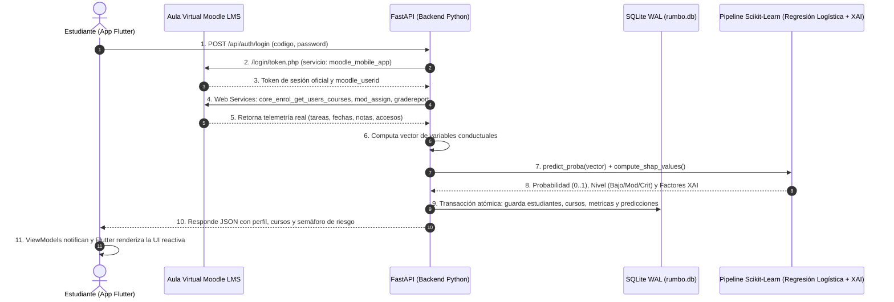

# Rumbo · Mobile Learning Moodle
> **Sistema Inteligente de Analítica Predictiva y Prevención del Riesgo Académico en Moodle**  
> *Facultad de Ingeniería de Sistemas e Informática (FISI) — Universidad Nacional Mayor de San Marcos (UNMSM)*  
> *Curso: Taller de Construcción de Software Móvil — Docente: Dr. Iván Carlo Petrlik Azabache*

---

## 📋 Tabla de Contenidos
1. [Descripción General](#-descripción-general)
2. [Guía para Expositores: De Dónde Viene Qué y Cómo Funciona](#-guía-para-expositores-de-dónde-viene-qué-y-cómo-funciona)
   - [El Flujo de Datos Completo (Moodle ➔ Backend ➔ ML ➔ Flutter)](#el-flujo-de-datos-completo)
   - [¿De dónde saca Moodle la información?](#de-dónde-saca-moodle-la-información)
   - [¿Cómo calcula la IA el riesgo y los factores?](#cómo-calcula-la-ia-el-riesgo-y-los-factores)
   - [¿Cómo viaja y se muestra en la App Móvil?](#cómo-viaja-y-se-muestra-en-la-app-móvil)
3. [Explicación Pantalla por Pantalla para la Demo](#-explicación-pantalla-por-pantalla-para-la-demo)
4. [Alineación con las Guías de Laboratorio (`Teoria_usar`)](#-alineación-con-las-guías-de-laboratorio-teoria_usar)
5. [Arquitectura del Sistema](#-arquitectura-del-sistema)
   - [Frontend: Patrón MVVM en Flutter](#frontend-patrón-mvvm-en-flutter)
   - [Backend: FastAPI y Microservicio Analítico](#backend-fastapi-y-microservicio-analítico)
6. [Base de Datos Relacional (`rumbo.db`)](#-base-de-datos-relacional-rumbodb)
7. [Modelo de Machine Learning y Explicabilidad XAI](#-modelo-de-machine-learning-y-explicabilidad-xai)
8. [Gamificación: Sistema de 6 Rangos adaptado a 14 Semanas](#-gamificación-sistema-de-6-rangos-adaptado-a-14-semanas)
9. [Persistencia Local con `SharedPreferences` (Lab 06)](#-persistencia-local-con-sharedpreferences-lab-06)
10. [Guía de Instalación y Ejecución Rápida](#-guía-de-instalación-y-ejecución-rápida)
11. [Cuentas y Credenciales para la Presentación](#-cuentas-y-credenciales-para-la-presentación)
12. [Preguntas Típicas del Jurado/Profesor y Cómo Responder](#-preguntas-típicas-del-juradoprofesor-y-cómo-responder)

---

## 🎯 Descripción General

**RUMBO** es una plataforma móvil orientada a la **retención estudiantil y autorregulación del aprendizaje** en la educación superior. Se conecta directamente al aula virtual **Moodle LMS** (MoodleCloud / Moodle institucional) para:
1. Extraer en tiempo real las métricas de interacción académica del estudiante (inactividad, entregas de tareas, notas de cuestionarios y frecuencia de acceso).
2. Procesar estos indicadores mediante un modelo de **Machine Learning (Regresión Logística con explicabilidad XAI)** para predecir oportunamente la probabilidad de riesgo de desaprobación o rezago.
3. Brindar al estudiante alertas tempranas comprensibles, dashboards explicativos con gráficos visuales y herramientas metacognitivas con un sistema de gamificación progresivo.

---

## 🧠 Guía para Expositores: De Dónde Viene Qué y Cómo Funciona

Esta sección está diseñada para que cualquier miembro del equipo que exponga el sábado entienda el ciclo de vida completo del sistema:

### El Flujo de Datos Completo



### ¿De dónde saca Moodle la información?
- **Notas y Evaluaciones**: Se consultan a través de la API oficial `gradereport_user_get_grade_items`. De aquí se calculan el `promedio_historico`, el `promedio_quizzes` y la `tendencia_calificaciones` (Slope de notas).
- **Tareas y Plazos**: Se obtienen con `mod_assign_get_assignments`. El backend revisa si la tarea está calificada, entregada o vencida, y computa el `margen_entrega_horas` (si el alumno entrega con días de anticipación o a última hora).
- **Último Acceso e Inactividad**: Se extrae de `core_enrol_get_users_courses` (`lastaccess`). Si el alumno no ha entrado en 5 días, `dias_inactividad = 5`.
- **Frecuencia Semanal**: Se contabilizan los días activos únicos en `historial_accesos`.

### ¿Cómo calcula la IA el riesgo y los factores?
1. **Vector de Características**: El backend toma las variables del alumno y las estandariza usando `StandardScaler` (`scaler.joblib`).
2. **Clasificación**: El modelo `LogisticRegression` (`model.joblib`) calcula la probabilidad exacta de riesgo ($P \in [0.0, 1.0]$) a través de la función sigmoide.
3. **Bandas de Decisión**:
   - 🟢 **BAJO** (0% - 39%): Ritmo de estudio óptimo.
   - 🟡 **MODERADO** (40% - 59%): Señales de alerta temprana que conviene atender.
   - 🔴 **CRÍTICO** (60% - 100%): Alto riesgo de reprobar; se activa recomendación correctiva inmediata.
4. **Explicabilidad con SHAP**: No es una "caja negra". SHAP desglosa qué variables **aumentan el riesgo** (ej: 1 tarea vencida, 8 días sin entrar) y cuáles **juegan a favor** (ej: promedio de 16 en cuestionarios). Esto genera los textos y gráficos de la pantalla de factores.

### ¿Cómo viaja y se muestra en la App Móvil?
1. El backend devuelve un contrato JSON tipado (`RiskDetailResponse`).
2. En Flutter, [`ApiService`](file:///c:/Users/camil/Desktop/ProyectoMobileLV1.0/Frontend/lib/data/services/api_service.dart) deserializa el JSON en objetos Dart inmutables mediante constructores `fromJson`.
3. Los ViewModels (`RiesgoViewModel`, `CoursesViewModel`) actualizan su estado interno y llaman a `notifyListeners()`.
4. Los widgets suscritos (`Consumer`, `context.watch`) se redibujan de forma eficiente y fluida.

---

## 📱 Explicación Pantalla por Pantalla para la Demo

Durante la presentación del sábado, sigan este recorrido en la app:

| Pantalla | Qué Mostrar | Concepto Clave a Mencionar |
| :--- | :--- | :--- |
| **1. Login (`LoginScreen`)** | Mostrar los botones de acceso rápido (**Guillermo**, **Joseph** o **DEMO**). Al presionar uno, se autocompletan las credenciales. | Autenticación real contra Moodle Web Services + Soporte de Contingencia Offline. |
| **2. Asignaturas (`CoursesScreen`)** | Mostrar la tarjeta de resumen superior (cuántos cursos en Bajo, Moderado o Crítico) y la lista de cursos ordenados con semáforo. | **Heurística de Nielsen (Visibilidad del estado)**. Pull-to-refresh para actualizar en vivo. |
| **3. Porcentaje de Riesgo (`RiskScreen`)** | Tocar un curso (ej: *Patrones de Diseño* o *Garantía de Software*). Mostrar el tacómetro visual, el rango de confianza (ej: `78–91%`), el banner de alerta y la acción inmediata recomendada. | **Heurística H6 de Nielsen (Margen de incertidumbre)**. Menú inferior flotante (`LiquidGlassNavBar`) que sigue presente. |
| **4. ¿Por qué este resultado? (`FactorsScreen`)** | Presionar el botón «¿Por qué este resultado?». Mostrar los 4 gráficos interactivos (círculos de días activos, tendencia de notas, línea de tiempo de tareas y accesos). Tocar una tarea para abrir el modal inferior de detalle. | **Inteligencia Artificial Explicable (XAI / SHAP)**. Se explica el motivo del cálculo en vez de dar un número ciego. |
| **5. Gamificación (`GamificationScreen`)** | Tocar el icono de medalla en el menú inferior. Mostrar el nivel/rango actual del alumno (ej: *Aprendiz*, *Explorador*, *Estratega*), la barra de XP acumulable, el avatar con marco dinámico (`TierAvatar`) y las 5 misiones semanales. | **Diseño adaptado a 14 semanas**: los niveles y títulos nunca se pierden; los objetivos semanales se renuevan. |
| **6. Tutor IA y Metacognición (`MetacognitiveScreen`)** | Mostrar las sugerencias pedagógicas y las herramientas de autogestión del estudio. | Autorregulación metacognitiva basada en Mobile Learning. |
| **7. Menú Lateral (`AppDrawer`) y Tema** | Abrir el drawer lateral desde el botón superior. Mostrar el perfil del alumno, su insignia de rango y accionar el **Switch de Modo Oscuro / Modo Claro**. Cerrar y volver a abrir la app. | **Persistencia local con `SharedPreferences` (Laboratorio 06)**: el tema se recuerda en el dispositivo. |

---

## 📚 Alineación con las Guías de Laboratorio (`Teoria_usar`)

Para demostrarle al profesor Dr. Iván Petrlik que se cubrió la totalidad del temario de su curso:

| Sesión / Guía | Tema del Profesor | Implementación en Rumbo | Archivo en el Repositorio |
| :--- | :--- | :--- | :--- |
| **Sesión 3 PPTX** | Planificación Ágil Scrum | Historias de usuario, sprints de desarrollo y roles del Grupo 5. | [`Docs/InformacionSobreLaApp/`](file:///c:/Users/camil/Desktop/ProyectoMobileLV1.0/Docs/InformacionSobreLaApp/) |
| **Sesión 3 Lab** | Widgets básicos, ListView, Tabs y Drawer | UI modular en Flutter, listas reactivas, Drawer de usuario y barra de pestañas. | [`app_drawer.dart`](file:///c:/Users/camil/Desktop/ProyectoMobileLV1.0/Frontend/lib/views/widgets/app_drawer.dart), [`liquid_glass_nav_bar.dart`](file:///c:/Users/camil/Desktop/ProyectoMobileLV1.0/Frontend/lib/views/widgets/liquid_glass_nav_bar.dart) |
| **Sesión 4 Lab** | Consumo de API REST JSON (`http`) | Cliente HTTP en Dart con deserialización `fromJson` y modelos fuertemente tipados. | [`api_service.dart`](file:///c:/Users/camil/Desktop/ProyectoMobileLV1.0/Frontend/lib/data/services/api_service.dart), [`course_model.dart`](file:///c:/Users/camil/Desktop/ProyectoMobileLV1.0/Frontend/lib/data/models/course_model.dart) |
| **Sesión 5 Lab** | Backend con **FastAPI** | Servidor ASGI con Uvicorn, rutas decoradas con `@app.get` y `@app.post`, esquemas Pydantic y Swagger. | [`Backend/main.py`](file:///c:/Users/camil/Desktop/ProyectoMobileLV1.0/Backend/main.py), [`Backend/app/routes/`](file:///c:/Users/camil/Desktop/ProyectoMobileLV1.0/Backend/app/routes/) |
| **Sesión 6 Lab** | **SharedPreferences** (Persistencia Local) | Almacenamiento local de la preferencia de Modo Claro / Oscuro en disco sin bloquear la UI. | [`theme_viewmodel.dart`](file:///c:/Users/camil/Desktop/ProyectoMobileLV1.0/Frontend/lib/viewmodels/theme_viewmodel.dart), [`theme_viewmodel_test.dart`](file:///c:/Users/camil/Desktop/ProyectoMobileLV1.0/Frontend/test/theme_viewmodel_test.dart) |
| **Sesión 7 Lab** | Inteligencia Artificial y Despliegue en Render | Modelo de Machine Learning educativo (Regresión Logística + XAI) y archivo de despliegue en la nube. | [`ml_service.py`](file:///c:/Users/camil/Desktop/ProyectoMobileLV1.0/Backend/app/services/ml_service.py), [`render.yaml`](file:///c:/Users/camil/Desktop/ProyectoMobileLV1.0/render.yaml) |
| **Diseño Móvil PPTX**| Arquitectura MVVM, DI y **SQLite** Relacional | MVVM con Provider, inyección de fakes en 62 pruebas unitarias y SQLite con claves foráneas. | [`rumbo.db`](file:///c:/Users/camil/Desktop/ProyectoMobileLV1.0/Backend/rumbo.db), [`database.py`](file:///c:/Users/camil/Desktop/ProyectoMobileLV1.0/Backend/app/database.py) |

---

## 🏛 Arquitectura del Sistema

> 📄 **Diagrama Visual HD y Documentación**: Consulta [`Docs/diagrama_arquitectura_app.png`](file:///c:/Users/camil/Desktop/ProyectoMobileLV1.0/Docs/diagrama_arquitectura_app.png) y [`Docs/ARQUITECTURA_DE_LA_APP.md`](file:///c:/Users/camil/Desktop/ProyectoMobileLV1.0/Docs/ARQUITECTURA_DE_LA_APP.md) para el diseño estructurado en 3 columnas (*Frontend Móvil*, *Backend y Motor ML*, *Servicios Externos y Almacenamiento*).

### Frontend: Patrón MVVM en Flutter
```
Frontend/lib/
├── core/theme/app_theme.dart             # Tokens de diseño, colores dinámicos (Light/Dark)
├── data/
│   ├── models/                           # DTOs inmutables (Student, Course, RiskDetail, Tier)
│   └── services/                         # ApiService (REST) y SyncCoordinator (Offline sync)
├── viewmodels/                           # Capa de Lógica de Presentación (ChangeNotifier)
│   ├── auth_viewmodel.dart               # Autenticación, sesión y perfil
│   ├── courses_viewmodel.dart            # Listado de cursos y semáforo de riesgo
│   ├── riesgo_viewmodel.dart             # Tacómetro, Heurística H6 y métricas
│   ├── metacognitive_viewmodel.dart      # Diagnósticos y revisión semanal
│   ├── theme_viewmodel.dart              # Tema reactivo persistido con SharedPreferences
│   └── tutor_viewmodel.dart              # Interacción con el Asistente IA
└── views/
    ├── screens/                          # Pantallas completas (Login, Courses, Risk, Factors, Gamification)
    └── widgets/                          # LiquidGlassNavBar, AppDrawer, TierAvatar, Charts
```

### Backend: FastAPI y Microservicio Analítico
```
Backend/
├── app/
│   ├── routes/                           # Endpoints REST (auth.py, cursos.py, predict.py, tutor.py)
│   ├── services/                         # moodle_service.py, ml_service.py, data_service.py
│   ├── database.py                       # Conexión SQLite WAL y esquema de 6 tablas
│   ├── models.py                         # Esquemas de validación Pydantic v2
│   └── main.py                           # Punto de entrada FastAPI con CORS
├── ml_models/                            # Artefactos serializados (model.joblib, scaler.joblib, features.joblib)
├── rumbo.db                              # Base de datos SQLite operativa
├── test_api.py                           # Suite de pruebas automatizadas del Backend (5/5)
└── requirements.txt                      # Dependencias de Python (fastapi, scikit-learn, etc.)
```

> 📄 **Diagramas Oficiales de Arquitectura para la Exposición**:
> - 🏛️ **Arquitectura General del Sistema (3 Bloques)**: [`Docs/ARQUITECTURA_DE_LA_APP.md`](file:///c:/Users/camil/Desktop/ProyectoMobileLV1.0/Docs/ARQUITECTURA_DE_LA_APP.md) · Imagen: [`Docs/diagrama_arquitectura_app.png`](file:///c:/Users/camil/Desktop/ProyectoMobileLV1.0/Docs/diagrama_arquitectura_app.png)
> - 🧩 **Diagrama Multicapa del Backend (C4 Componentes)**: [`Docs/DIAGRAMA_MULTICAPA_BACKEND.md`](file:///c:/Users/camil/Desktop/ProyectoMobileLV1.0/Docs/DIAGRAMA_MULTICAPA_BACKEND.md) · Imagen: [`Docs/diagrama_multicapa_backend.png`](file:///c:/Users/camil/Desktop/ProyectoMobileLV1.0/Docs/diagrama_multicapa_backend.png)

---

## 🗄 Base de Datos Relacional (`rumbo.db`)

La base de datos local SQLite opera con **Write-Ahead Logging (`PRAGMA journal_mode = WAL;`)** y claves foráneas activadas (`PRAGMA foreign_keys = ON;`), asegurando concurrencia de lectura y transacciones ACID.

Consiste en **6 tablas relacionales**:
1. **`estudiantes`**: Perfil universitario, `username` de Moodle y token Web Service.
2. **`cursos`**: Asignaturas matriculadas vinculadas a cada estudiante (`id_estudiante`).
3. **`metricas`**: Telemetría extraída de Moodle (inactividad, tareas pendientes, promedio, slope de notas, margen de entrega, asistencia).
4. **`predicciones`**: Resultado de inferencia de la IA (probabilidad, porcentaje, nivel de riesgo, rangos H6 de Nielsen y JSON explicativo de factores).
5. **`historial_accesos`**: Marcas de tiempo de los accesos diarios para validar la misión de días activos.
6. **`revisiones_diagnostico`**: Registro de revisiones semanales de diagnóstico (`semana_lunes`) para el logro *Estratega del Aprendizaje*.

> 📄 **Documentación completa y diagrama visual**: Consulta [`Docs/DIAGRAMA_BASE_DE_DATOS.md`](file:///c:/Users/camil/Desktop/ProyectoMobileLV1.0/Docs/DIAGRAMA_BASE_DE_DATOS.md) y [`Docs/diagrama_er_base_de_datos.png`](file:///c:/Users/camil/Desktop/ProyectoMobileLV1.0/Docs/diagrama_er_base_de_datos.png).

---

## 🤖 Modelo de Machine Learning y Explicabilidad XAI

- **Algoritmo**: `LogisticRegression` supervisado (`C=1.0`, `max_iter=1000`) + `StandardScaler` (7 variables predictoras).
- **Explicabilidad (XAI)**: Coeficientes ponderados ($\beta$) intrínsecos de la regresión logística que descomponen el riesgo de forma transparente en factores protectores ($\beta < 0$, como alto promedio y entregas anticipadas) y factores de riesgo ($\beta > 0$, como inactividad prolongada y tareas pendientes).
- **Entrenamiento**: Realizado con un dataset longitudinal de panel con 7,500 registros calibrados a la escala académica 0–20 de la UNMSM y validación cruzada.
- **Inferencia en Tiempo Real**: El backend recibe el ID del alumno, obtiene sus métricas de Moodle/BD, genera la predicción en $< 50\text{ ms}$ y la retorna formateada a Flutter.

---

## 🎮 Gamificación: Sistema de 6 Rangos adaptado a 14 Semanas

Diseñado pedagógicamente para un semestre académico estándar de **14 semanas**:

| Rango | Nombre del Título | XP Acumulado Requerido | Distintivo / Cosmético |
| :---: | :--- | :---: | :--- |
| **Rango 1** | 🥉 **Novato del Aula** | 0 – 349 XP | Borde gris pizarra sutil |
| **Rango 2** | 🥈 **Aprendiz Constante** | 350 – 799 XP | Borde azul cielo con brillo |
| **Rango 3** | 🥇 **Explorador Académico** | 800 – 1,399 XP | Borde esmeralda vibrante |
| **Rango 4** | 💎 **Estratega Digital** | 1,400 – 2,099 XP | Borde violeta real con sombra |
| **Rango 5** | 👑 **Maestro del Aprendizaje** | 2,100 – 2,899 XP | Borde dorado ambarino |
| **Rango 6** | 🌌 **Erudito Legendario** | 2,900+ XP | Borde gradiente arcoíris místico |

### ¿Cómo funciona el reseteo semanal?
- **El XP Total NUNCA se borra**: Los puntos de experiencia acumulados y el rango alcanzado son permanentes durante todo el ciclo.
- **Las 5 Misiones Semanales se renuevan cada lunes**:
  1. *Constancia Semanal* (100 XP): Entrar al menos 4 días diferentes a Moodle.
  2. *Estratega del Aprendizaje* (120 XP): Revisar el diagnóstico «¿Por qué este resultado?» en todos los cursos.
  3. *As de los Cuestionarios* (100 XP): Promedio $\ge 14.0$ en evaluaciones.
  4. *Mente Inquisitiva* (80 XP): Realizar 3 consultas al Tutor IA.
  5. *Entrega Impecable* (100 XP): Cero tareas vencidas en la semana.

---

## 💾 Persistencia Local con `SharedPreferences` (Lab 06)

En cumplimiento de la consigna del Laboratorio N° 06 (*«Implementar SharedPreferences en alguna parte del proyecto grupal y evidenciarlo»*):
- Implementado en [`ThemeViewModel`](file:///c:/Users/camil/Desktop/ProyectoMobileLV1.0/Frontend/lib/viewmodels/theme_viewmodel.dart).
- Almacena el valor booleano `app_theme_is_dark` en el almacenamiento local del dispositivo.
- **Ventaja Técnica**: Cuando el estudiante cierra la aplicación o reinicia su celular, la app recuerda de inmediato su elección de Modo Claro o Modo Oscuro desde el arranque, sin consultar al servidor ni parpadear.
- **Pruebas Automatizadas**: Verificado en [`theme_viewmodel_test.dart`](file:///c:/Users/camil/Desktop/ProyectoMobileLV1.0/Frontend/test/theme_viewmodel_test.dart).

---

## 💻 Guía de Instalación y Ejecución Rápida

### 1. Levantar el Backend (FastAPI)
Requiere Python 3.10 o superior:
```bash
# Entrar a la carpeta del backend
cd Backend

# Activar el entorno virtual
.\venv\Scripts\activate      # En Windows
# source venv/bin/activate   # En Linux / macOS

# Instalar dependencias (si es primera vez)
pip install -r requirements.txt

# Iniciar el servidor FastAPI con recarga en caliente
uvicorn app.main:app --reload --port 8000
```
- **API Activa:** `http://127.0.0.1:8000`
- **Swagger UI (Documentación interactiva):** `http://127.0.0.1:8000/docs`

### 2. Levantar el Frontend (Flutter)
Requiere Flutter SDK 3.x o superior:
```bash
# Entrar a la carpeta del frontend
cd Frontend

# Descargar paquetes
flutter pub get

# Ejecutar en Google Chrome (Recomendado para la demo rápida)
flutter run -d chrome

# O en Windows Desktop / Emulador Android
flutter run -d windows
```

### 3. Ejecutar las Pruebas Automatizadas
```bash
# En Backend:
python Backend/test_api.py      # Debe salir: TODAS LAS PRUEBAS PASARON (5/5)

# En Frontend:
flutter analyze                 # Debe salir: No issues found!
flutter test                    # Debe salir: 62/62 All tests passed!
```

---

## 🔑 Cuentas y Credenciales para la Presentación

En la pantalla de Login, encontrarán los botones de autocompletado rápido:

| Cuenta / Botón | Código | Contraseña | Rol / Utilidad para la Exposición |
| :--- | :--- | :--- | :--- |
| **`guillermo1234`** | `guillermo1234` | `Base22SW42` | **Estudiante Oficial MoodleCloud (UNMSM FISI)**.<br>Tiene 3 cursos reales con riesgo Crítico y Bajo para mostrar la semaforización en vivo. |
| **`josephr.c27`** | `josephr.c27` | `Base22SW41` | **Estudiante Oficial MoodleCloud (UNMSM FISI)**.<br>Tiene 2 cursos reales matriculados. |
| **`DEMO`** | `DEMO` | `demo123` | **Modo de Contingencia Offline**.<br>Carga datos de simulación completos si la conexión a internet de la sala fallara. |

---

## ❓ Preguntas Típicas del Jurado/Profesor y Cómo Responder

Para estar 100% preparados ante las preguntas del Dr. Petrlik o los jurados:

#### 1. «¿Por qué usaron MVVM en Flutter en lugar de MVC tradicional?»
> *"Profesor, elegimos **MVVM con Provider** porque en Flutter la interfaz de usuario es declarativa. El ViewModel encapsula el estado y las reglas de presentación mediante `ChangeNotifier`, exponiendo datos observables. Esto desacopla totalmente las pantallas (`Views`) de la capa de red (`ApiService`), permitiéndonos probar la lógica visual mediante 62 pruebas unitarias con dependencias simuladas (`FakeApi`), exactamente como se explica en la Diapositiva 10 de su clase de Diseño Móvil."*

#### 2. «En la Guía 7 se usaba Flask, ¿por qué en su backend tienen FastAPI?»
> *"Profesor, en la Guía 5 aprendimos **FastAPI** con Uvicorn, y decidimos adoptarlo como un sustituto superior a Flask para nuestro proyecto final porque ofrece tipado estricto con Pydantic v2, generación automática de documentación Swagger interactiva (`/docs`), soporte nativo asíncrono y un rendimiento significativamente mayor para atender peticiones concurrentes del cliente móvil."*

#### 3. «¿Dónde y cómo evidencian el uso de SharedPreferences del Laboratorio 06?»
> *"Lo implementamos en el [`ThemeViewModel`](file:///c:/Users/camil/Desktop/ProyectoMobileLV1.0/Frontend/lib/viewmodels/theme_viewmodel.dart) para persistir la preferencia de Modo Claro / Modo Oscuro en el almacenamiento local del dispositivo. Cuando el alumno abre la app, se lee inmediatamente el booleano `app_theme_is_dark` de `SharedPreferences`, logrando que la interfaz cargue en el modo correcto sin consultar al servidor. Lo tenemos respaldado con pruebas en [`theme_viewmodel_test.dart`](file:///c:/Users/camil/Desktop/ProyectoMobileLV1.0/Frontend/test/theme_viewmodel_test.dart)."*

#### 4. «¿Cómo funciona la explicabilidad de la IA? ¿Por qué no mostrar solo el porcentaje?»
> *"Un porcentaje aislado de riesgo no le dice al estudiante qué debe hacer para mejorar. Siguiendo los principios de **XAI (Inteligencia Artificial Explicable)** y la **Heurística H6 de Jakob Nielsen**, implementamos un tacómetro con margen de incertidumbre y calculamos valores **SHAP** que desglosan exactamente qué factores suman riesgo (ej: inactividad de 8 días o tareas pendientes) y qué factores juegan a favor (ej: buen promedio en cuestionarios), ofreciendo una recomendación correctiva inmediata."*

#### 5. «¿Cómo se resetean los puntos de gamificación entre semanas?»
> *"Los puntos de experiencia totales acumulados y los títulos de rango nunca se resetean; reflejan el progreso acumulado durante las 14 semanas del ciclo. Lo que se renueva cada semana son las **5 misiones de autorregulación** (como constancia de 4 días de ingreso o revisión de diagnósticos), fomentando la disciplina continua a lo largo del semestre."*

---

### ¡Mucho éxito en la exposición del sábado, equipo! 🚀
Cualquier consulta técnica adicional, revisen los archivos en [`Docs/`](file:///c:/Users/camil/Desktop/ProyectoMobileLV1.0/Docs/) y los tests en [`Frontend/test/`](file:///c:/Users/camil/Desktop/ProyectoMobileLV1.0/Frontend/test/).
