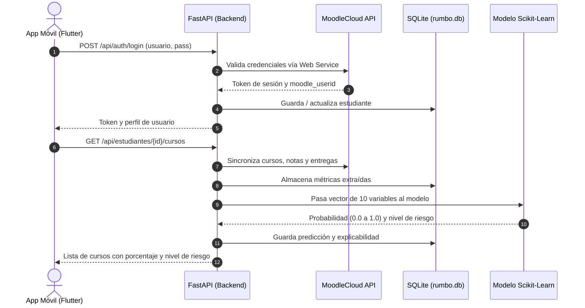

# Rumbo · Mobile Learning Moodle
> **Sistema Inteligente de Analítica Predictiva y Prevención del Riesgo Académico en Moodle**  
> *Facultad de Ingeniería de Sistemas e Informática (FISI) — UNMSM*

---

## 📋 Tabla de Contenidos
1. [Descripción General](#-descripción-general)
2. [Estado Actual del Proyecto (Lo que ya está hecho)](#-estado-actual-del-proyecto-lo-que-ya-está-hecho)
3. [Arquitectura del Sistema](#-arquitectura-del-sistema)
   - [Patrón MVVM en Flutter](#a-patrón-mvvm-en-el-frontend-flutter)
   - [Flujo de Datos de Inferencia ML](#b-flujo-de-datos-moodle--bd--ml--flutter)
4. [Estructura del Repositorio](#-estructura-del-repositorio)
5. [Base de Datos (`rumbo.db`)](#-base-de-datos-rumbodb)
6. [Modelo de Machine Learning](#-modelo-de-machine-learning)
7. [Guía de Instalación y Ejecución](#-guía-de-instalación-y-ejecución)
   - [1. Backend (FastAPI)](#1-ejecutar-el-backend-fastapi)
   - [2. Frontend (Flutter)](#2-ejecutar-el-frontend-flutter)
8. [Ejecución de Pruebas Automatizadas](#-ejecución-de-pruebas-automatizadas)
9. [Cuentas y Credenciales de Prueba](#-cuentas-y-credenciales-de-prueba)
10. [Guía para el Equipo: ¿Cómo continuar el desarrollo?](#-guía-para-el-equipo-cómo-continuar-el-desarrollo)

---

## 🎯 Descripción General

**Rumbo** es una aplicación móvil diseñada bajo los lineamientos de **Mobile Learning** e **IA explicable (XAI)**. Se integra con aulas virtuales **Moodle** (MoodleCloud / Moodle institucional) para:
1. Extraer en tiempo real las métricas de interacción del estudiante (accesos, tareas entregadas y pendientes, calificaciones históricas e inactividad).
2. Procesar los indicadores mediante un modelo de **Machine Learning supervisado** (Regresión Logística / Random Forest) para predecir la probabilidad de riesgo de desaprobación o rezago.
3. Proporcionar a los estudiantes alertas tempranas accionables, dashboards explicativos con gráficos visuales y herramientas de autorregulación metacognitiva.

---

## 🚀 Estado Actual del Proyecto (Lo que ya está hecho)

Hasta el momento, el proyecto cumple con todos los requerimientos base solicitados:

### Frontend (Flutter)
- ✅ **Patrón Arquitectural MVVM**: Separación estricta entre Modelos (`lib/data/models`), ViewModels con `ChangeNotifier` / `Provider` (`lib/viewmodels`) y Vistas (`lib/views`).
- ✅ **Soporte de Tema Dual (Modo Claro & Modo Oscuro)**: Implementado en `ThemeViewModel` y `AppTheme`, con alternancia en tiempo real mediante botón en el Header y en el Menú Lateral.
- ✅ **Menú Hamburguesa (`AppDrawer`)**: Drawer lateral deslizable con datos del estudiante autenticado, switch de tema oscuro, enlaces de navegación a los 4 módulos y botón de cierre de sesión.
- ✅ **Pantallas Principales Consolidadas**:
  - `LoginScreen`: Autenticación real contra Moodle y chips de acceso rápido con credenciales de prueba.
  - `CoursesScreen`: Lista de cursos matriculados, cálculo visual de distribución de riesgo (Bajo, Moderado, Crítico) y pull-to-refresh.
  - `RiskScreen`: Tacómetro semicircular (*RiskGauge*), rango de confianza basado en la Heurística H6 de Nielsen y acción correctiva inmediata recomendada.
  - `FactorsScreen`: Pantalla de explicabilidad XAI con 4 gráficos interactivos (inactividad, tendencia de notas, línea de tiempo de tareas y accesos semanales).
- ✅ **Pantallas Base Creadas (Placeholders)**:
  - `MetacognitiveScreen`: Espacio para Estrategia 4 (control y autogestión del estudio).
  - `TutorScreen`: Espacio para Asistente Inteligente IA.
  - `GamificationScreen`: Espacio para Estrategia 5 (logros, medallas y rachas).
- ✅ **12/12 Pruebas de Widgets y UI Pasando**: Cobertura en `Frontend/test/`.

### Backend (FastAPI & Python)
- ✅ **Integración con Moodle Web Services**: Servicio `moodle_service.py` que consume la REST API oficial de Moodle (`core_enrol_get_users_courses`, `mod_assign_get_assignments`, `gradereport_user_get_grade_items`).
- ✅ **Persistencia en SQLite (`Backend/rumbo.db`)**: Base de datos relacional con 4 tablas (`estudiantes`, `cursos`, `metricas`, `predicciones`).
- ✅ **Inferencia ML en Tiempo Real**: Carga del pipeline de Scikit-Learn (`model.joblib` + `scaler.joblib`) y generación de probabilidades y niveles de riesgo.
- ✅ **Endpoints REST Documentados**: Disponibles en Swagger UI (`/docs`).
- ✅ **5/5 Pruebas de Integración Pasando**: Script `test_api.py` que valida el flujo completo.

---

## 🏗 Arquitectura del Sistema

### A. Patrón MVVM en el Frontend (Flutter)

```
Frontend/lib/
│
├── data/
│   ├── models/            # DTOs inmutables (StudentModel, CourseModel, RiskDetailModel)
│   └── services/          # Consumo HTTP (ApiService) con fallback de contingencia
│
├── viewmodels/            # Lógica de presentación y estado (Provider)
│   ├── auth_viewmodel.dart      # Gestión de login, sesión y logout
│   ├── courses_viewmodel.dart   # Carga y filtrado de cursos
│   ├── riesgo_viewmodel.dart    # Detalle de predicción y métricas del curso
│   └── theme_viewmodel.dart     # Control reactivo del Modo Claro/Oscuro
│
└── views/                 # Interfaz gráfica reactiva
    ├── screens/           # Pantallas completas
    └── widgets/           # Tacómetro (Gauge), tarjetas, gráficos y AppDrawer
```

### B. Flujo de Datos: Moodle ➔ BD ➔ ML ➔ Flutter



---

## 📁 Estructura del Repositorio

```text
ProyectoMobileLV1.0/
├── Backend/
│   ├── app/
│   │   ├── routes/
│   │   │   ├── auth.py             # Endpoint de autenticación (/api/auth/login)
│   │   │   ├── cursos.py           # Endpoints de cursos y riesgo (/api/estudiantes/...)
│   │   │   └── predict.py          # Inferencia directa (/api/predict)
│   │   ├── services/
│   │   │   ├── data_service.py     # Acceso a datos de prueba
│   │   │   ├── ml_service.py       # Carga de joblib, cálculo de nivel y textos XAI
│   │   │   └── moodle_service.py   # Conexión oficial a Moodle Web Services REST
│   │   ├── database.py             # Inicialización y conexiones a SQLite (rumbo.db)
│   │   ├── main.py                 # Instancia de FastAPI, CORS y registro de routers
│   │   └── models.py               # Esquemas Pydantic de entrada y salida
│   ├── ml_models/
│   │   ├── features.joblib         # Lista de nombres de las 10 variables predictoras
│   │   ├── model.joblib            # Modelo entrenado (LogisticRegression)
│   │   └── scaler.joblib           # StandardScaler ajustado para normalizar variables
│   ├── rumbo.db                    # Base de datos SQLite local
│   ├── requirements.txt            # Dependencias Python
│   ├── run.py                      # Script para levantar el servidor
│   ├── test_api.py                 # Suite de pruebas automatizadas del Backend (5 tests)
│   └── test_moodle_service.py      # Diagnóstico directo con MoodleCloud
│
├── Frontend/
│   ├── lib/
│   │   ├── core/
│   │   │   ├── constants/api_constants.dart  # URLs base y timeouts del Backend
│   │   │   └── theme/app_theme.dart          # Paleta Rumbo (Light & Dark), tipografías
│   │   ├── data/
│   │   │   ├── models/                       # Modelos Dart (Student, Course, RiskDetail)
│   │   │   └── services/api_service.dart     # Cliente HTTP con manejo de errores y fallback
│   │   ├── viewmodels/                       # ViewModels (Auth, Courses, Riesgo, Theme)
│   │   ├── views/
│   │   │   ├── screens/                      # Pantallas principales y placeholders
│   │   │   └── widgets/                      # Tacómetro Gauge, AppDrawer, Gráficos
│   │   └── main.dart                         # Entry point con MultiProvider y MaterialApp
│   ├── test/                                 # 12 pruebas de widgets y pantallas
│   └── pubspec.yaml                          # Dependencias (provider, http, etc.)
│
├── Docs/                                     # Documentación académica y capturas
└── Entrenamiento/                            # Jupyter Notebook con el entrenamiento del modelo
```

---

## 🗄 Base de Datos (`rumbo.db`)

Ubicada en `Backend/rumbo.db`, es un SQLite que persiste la información operativa del sistema:

1. **`estudiantes`**: Almacena `id_estudiante`, `username`, `nombre`, `correo`, `token_moodle`, `moodle_userid`.
2. **`cursos`**: Asocia a los estudiantes con sus cursos de Moodle (`id_curso`, `moodle_id`, `nombre`, `codigo`, `docente`, `creditos`).
3. **`metricas`**: Guarda las 10 variables extraídas de Moodle (`dias_inactividad`, `tareas_totales`, `tareas_pendientes`, `promedio_historico`, etc.).
4. **`predicciones`**: Guarda el resultado de la inferencia (`probabilidad`, `porcentaje`, `nivel_riesgo`, `alerta_titulo`, `accion_recomendada`, `factores_json`).

---

## 🤖 Modelo de Machine Learning

- **Algoritmo**: `LogisticRegression` (con `StandardScaler`).
- **Ubicación de binarios**: `Backend/ml_models/`.
- **Variables Predictoras (10 features)**:
  1. `carga_academica_actual`: Número de créditos o asignaturas simultáneas.
  2. `calificacion_historica_promedio`: Promedio ponderado acumulado (escala 0 a 20).
  3. `tendencia_calificaciones`: Pendiente de cambio en las últimas notas (+ / -).
  4. `tasa_acierto_primer_intento`: Porcentaje de éxito en cuestionarios iniciales.
  5. `duracion_intento_minutos`: Tiempo promedio dedicado en plataforma por sesión.
  6. `indice_friccion_cognitiva`: Errores repetidos o reintentos en evaluaciones.
  7. `dias_inactividad_consecutivos`: Días transcurridos sin ingresar al curso.
  8. `tasa_entregas_tardias`: Proporción de tareas subidas después de la fecha límite.
  9. `nivel_interaccion_social`: Participación en foros y mensajes del aula.
  10. `tasa_visualizacion_materiales`: Recursos y lecturas visualizadas del total.

- **Niveles de Riesgo**:
  - 🟢 **BAJO** (0% - 30%): Ritmo estable.
  - 🟡 **MODERADO** (31% - 60%): Disminución leve en ingresos o entregas; acción preventiva.
  - 🔴 **CRÍTICO** (61% - 100%): Alto riesgo de desaprobación; recomendación de tutoría inmediata.

---

## 💻 Guía de Instalación y Ejecución

### 1. Ejecutar el Backend (FastAPI)

#### Requisitos:
- Python 3.10 o superior instalado.

#### Pasos:
```bash
# 1. Navegar a la carpeta del backend
cd Backend

# 2. (Opcional pero recomendado) Crear y activar entorno virtual
python -m venv venv
# En Windows:
.\venv\Scripts\activate
# En Linux/macOS:
source venv/bin/activate

# 3. Instalar dependencias
pip install -r requirements.txt

# 4. Iniciar el servidor
python run.py
```

- **Servidor activo en:** `http://127.0.0.1:8000`
- **Swagger UI (Documentación interactiva de endpoints):** `http://127.0.0.1:8000/docs`

---

### 2. Ejecutar el Frontend (Flutter)

#### Requisitos:
- Flutter SDK (versión 3.x o superior) instalado y configurado en el PATH.
- Chrome, emulador de Android o soporte de Windows Desktop habilitado.

#### Pasos:
```bash
# 1. Navegar a la carpeta del frontend
cd Frontend

# 2. Descargar las dependencias
flutter pub get

# 3. Ejecutar la aplicación en la plataforma deseada:
# En Chrome (Recomendado para pruebas rápidas):
flutter run -d chrome

# En Windows Desktop:
flutter run -d windows

# En Emulador Android:
flutter run -d android
```

> **Nota para emuladores Android:** Si ejecutas la app en un emulador Android, recuerda que para conectar al backend local debes usar la IP `10.0.2.2:8000` en lugar de `127.0.0.1:8000` (configurado en `Frontend/lib/core/constants/api_constants.dart`).

---

## 🧪 Ejecución de Pruebas Automatizadas

### Pruebas del Backend (Python)
Desde la carpeta `Backend/`:
```bash
python test_api.py
```
*Ejecuta 5 pruebas: raíz, login real en Moodle, listado de cursos, detalle de riesgo con métricas XAI e inferencia ML directa.*

### Pruebas del Frontend (Flutter)
Desde la carpeta `Frontend/`:
```bash
# Análisis estático (debe reportar 0 issues)
flutter analyze

# Suite completa de 12 tests de widgets y pantallas
flutter test
```

---

## 🔑 Cuentas y Credenciales de Prueba

En la pantalla de Login (`LoginScreen`) se encuentran botones de acceso rápido para demostración:

| Usuario | Contraseña | Rol / Descripción | Cursos Asignados en Moodle |
| :--- | :--- | :--- | :--- |
| **`guillermo1234`** | `Base22SW42` | **Estudiante Oficial (UNMSM FISI)** | 3 cursos reales sincronizados con MoodleCloud |
| **`josephr.c27`** | `Base22SW41` | **Estudiante Oficial (UNMSM FISI)** | 2 cursos reales sincronizados con MoodleCloud |
| **`DEMO`** | `demo123` | **Modo Demostración Offline** | Datos simulados para pruebas sin internet |

### Los 3 cursos reales de prueba son:
1. `Curso202W0907-TALLER_DE_CONSTRUCCION_DE_SOFTWARE_MOVIL-2018-1_26.2`
2. `GARANTIA DE SOFTWARE - G1`
3. `GESTION DE MANTENIMIENTO DEL SOFTWARE - G1`

---

## 👥 Guía para el Equipo: ¿Cómo continuar el desarrollo?

Si eres compañero de equipo y te toca implementar nuevas funcionalidades, aquí tienes el mapa de ruta:

### 1. Dónde implementar las nuevas pantallas
El menú lateral (`AppDrawer`) ya contiene los botones y la navegación hacia estas tres pantallas que están creadas como plantillas limpias:

1. **Control Metacognitivo** (`Frontend/lib/views/screens/metacognitive_screen.dart`):
   - **Objetivo**: Ayudar al estudiante a autorregular su aprendizaje (Estrategia 4).
   - **Qué construir**: Métricas de horas dedicadas, planificación de horarios, metas semanales de estudio y hábitos de autoevaluación.
2. **Tutor Inteligente IA** (`Frontend/lib/views/screens/tutor_screen.dart`):
   - **Objetivo**: Asistente conversacional inteligente.
   - **Qué construir**: Interfaz de chat interactiva que permita al alumno preguntar sobre dudas de los temas del curso o recomendaciones de estudio personalizadas.
3. **Gamificación y Logros** (`Frontend/lib/views/screens/gamification_screen.dart`):
   - **Objetivo**: Fomentar la permanencia y motivación (Estrategia 5).
   - **Qué construir**: Insignias (Badges), rachas de días seguidos ingresando a Moodle, puntos por entregar tareas con anticipación y niveles de progreso.

### 2. Cómo agregar un nuevo ViewModel (siguiendo MVVM)
1. Crea tu archivo en `Frontend/lib/viewmodels/nombre_viewmodel.dart`.
2. Hereda de `ChangeNotifier`:
   ```dart
   class MiViewModel extends ChangeNotifier {
     bool _isLoading = false;
     bool get isLoading => _isLoading;
     // ... tus estados y métodos con notifyListeners();
   }
   ```
3. Regístralo en el `MultiProvider` de `Frontend/lib/main.dart`:
   ```dart
   ChangeNotifierProvider(create: (_) => MiViewModel()),
   ```
4. Consúmelo en tu pantalla con `context.watch<MiViewModel>()` o `context.read<MiViewModel>()`.

### 3. Reglas de Diseño y Estilos (Dark / Light Mode)
- **Nunca quemes colores fijos como `Colors.white` o `Colors.black` en fondos o textos.**
- Utiliza siempre los helpers dinámicos de `AppColors`:
  - `AppColors.backgroundOf(context)` (Fondo de pantalla)
  - `AppColors.surfaceOf(context)` (Fondo de tarjetas y contenedores)
  - `AppColors.textPrimaryOf(context)` (Texto principal)
  - `AppColors.textSecondaryOf(context)` (Subtítulos y descripciones)
  - `AppColors.borderOf(context)` (Bordes de inputs y tarjetas)

### 4. Buenas Prácticas de Git antes de subir tus cambios
Antes de hacer commit y push a la rama `main`:
```bash
# 1. Asegúrate de que no haya errores de compilación o linter
flutter analyze

# 2. Asegúrate de que todos los tests sigan pasando
flutter test

# 3. Si todo está en verde, sube tus cambios:
git add .
git commit -m "feat(modulo): descripción clara de lo implementado"
git push origin main
```
